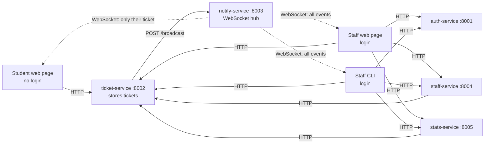
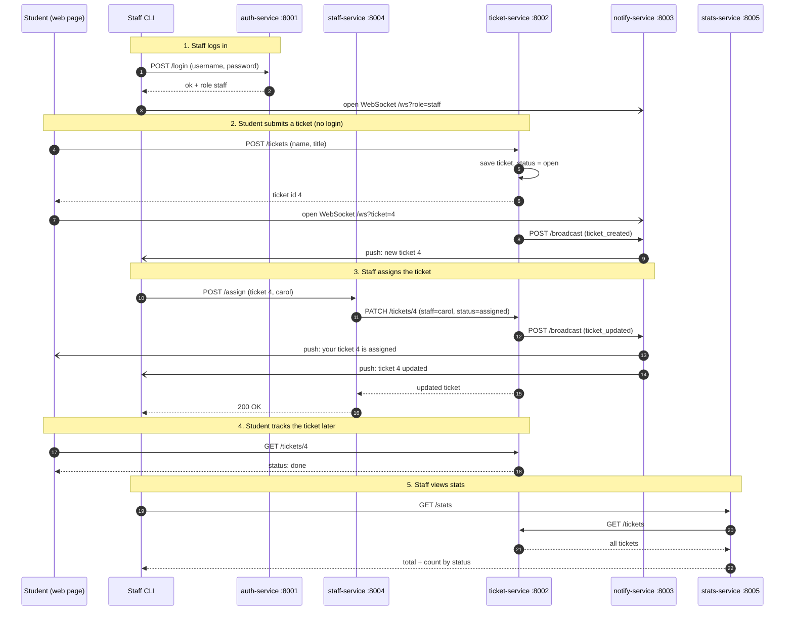

# Campus Help Desk — Distributed Back-End Project

## 1. The idea

Students report a problem (e.g. "Wi-Fi down in building B") **without logging
in** — they get back a ticket number and can watch its status change live on
the web page just by entering that number. Staff log in, pick up tickets,
assign them, and move them through `open → assigned → in_progress → done`.
Every change shows up instantly, for staff and for the student who owns that
ticket, with no page refresh. It's simple because there is exactly one piece
of data (a ticket) and one thing that changes about it (its status), which is
enough to justify 5 microservices and real-time WebSocket updates without any
extra complexity.

## 2. Architecture

| Service | Port | Job | Talks to |
|---|---|---|---|
| auth-service | 8001 | Staff login only: `POST /login` checks username + password | nothing |
| ticket-service | 8002 | The only service that stores tickets: create, list, get one, update | notify-service, after every create/update |
| notify-service | 8003 | The only service with WebSockets: `POST /broadcast` pushes events to connected clients | nothing (pushes to clients) |
| staff-service | 8004 | Staff list + `POST /assign` — does not store tickets itself, asks ticket-service to update | ticket-service |
| stats-service | 8005 | `GET /stats`: counts tickets by status | ticket-service |



The staff web page (`staff.html`) and the staff CLI are just two different
clients doing the same thing — both log in through auth-service and both
open a `role=staff` WebSocket. Pick whichever one you want to show in the
demo, or run both at once.

Rules shown in the chart:
- Students only ever talk to ticket-service — they never touch auth-service.
- Only ticket-service calls notify-service; staff-service and stats-service
  always go through ticket-service instead of storing or broadcasting
  anything themselves.
- notify-service sends **all** events to staff, and a student only receives
  events for their own ticket. Staff connect with
  `ws://localhost:8003/ws?role=staff`, students with
  `ws://localhost:8003/ws?ticket=<id>`.

### Workflow



### Clients

The web client is 3 plain HTML files (no build step, no framework) in
`clients/web_client/`:

- **`index.html`** — a landing page with two links: "Student" and "Staff".
  No logic beyond a couple of `<a href>` cards.
- **`student.html`** — no login. A form (name + problem) submits to
  ticket-service and shows "Your ticket #4". A "Track a ticket" box looks up
  any ticket number and opens a WebSocket scoped to that ticket, so status
  changes appear live.
- **`staff.html`** — a quick-login screen (one click for `carol` or `dave`,
  demo credentials filled in for you), then a ticket table with a status
  dropdown and an "Assign to me" button per row, a stats panel, and a live
  updates log. It opens a `role=staff` WebSocket on login so the whole table
  refreshes the moment anything changes.

There is also a **Staff CLI** (`clients/cli_client/cli.py`) as a second,
non-browser client: it asks for username + password against auth-service,
then offers a menu — list tickets, change status, assign ticket, view
stats, quit. A background thread holds a `role=staff` WebSocket and prints
`[LIVE]` events as they arrive. The staff web page and the staff CLI are
two independent clients of the same services — you can run either, or both
at once, and they'll stay in sync over WebSocket.

No database: everything lives in a Python list/dict inside `ticket-service`
(small hardcoded dicts in `auth-service`/`staff-service`). No Docker: every
service is a single `main.py` run directly with `python3`.

## 3. Install & run

```bash
pip install -r requirements.txt
```

### Run all 5 services

```bash
./run_all.sh
```

Or open 5 separate terminals for the demo, so you can point at each one:

```bash
python3 services/auth_service/main.py
python3 services/ticket_service/main.py
python3 services/notify_service/main.py
python3 services/staff_service/main.py
python3 services/stats_service/main.py
```

### Run the web client

Serve it from inside its own folder (don't just double-click the HTML file):

```bash
cd clients/web_client
python3 -m http.server 8080
```

Open `http://localhost:8080` — pick **Student** or **Staff**. Staff logs in
with one click (`carol` / `carol123` or `dave` / `dave123` are pre-filled).

### Run the staff CLI (optional second staff client)

```bash
python3 clients/cli_client/cli.py
```

Demo staff logins: `carol` / `carol123` or `dave` / `dave123`.

## 4. Demo script (4 steps)

1. Open the web page, choose **Student**, and submit a ticket (no login) —
   the page shows "Your ticket #1" and starts tracking it live.
2. In another tab, choose **Staff** and log in with one click as `carol`.
   The ticket immediately shows up in her table — no refresh, no polling.
3. As `carol`, click "Assign to me" or change the status dropdown. Switch
   back to the student tab: the badge and the "Live updates" box change
   instantly, because the student's page only opened a WebSocket for that
   one ticket number.
4. Point at the "Stats" panel on the staff page (or run the staff CLI and
   choose "View stats") to show `stats-service` pulling live counts from
   `ticket-service` over plain HTTP.

## 5. Defense cheat-sheet

**Why microservices instead of one app?**
Each service owns one small responsibility (auth, tickets, notifications,
staff, stats) and they only know each other's HTTP address — nothing is
imported or shared in memory between them.

**How do the services talk to each other?**
Plain HTTP with `httpx`: `staff-service` calls `PATCH /tickets/{id}` on
`ticket-service` to assign a ticket; `stats-service` calls `GET /tickets` to
compute counts; `ticket-service` calls `POST /broadcast` on `notify-service`
whenever a ticket is created or updated. Neither `staff-service` nor
`stats-service` touches `notify-service` directly — only `ticket-service`
does, because it's the only service that actually changes ticket data.

**Where is the real-time part, and why is it scoped?**
`notify-service` is the only service holding WebSocket connections. A
connection is tagged at connect time — `role=staff` gets every event, and
`ticket=<id>` only gets events for that one ticket. This is why a student
can safely track a ticket with just its number: they can't see anyone
else's tickets over the socket, because notify-service filters by the
`ticket` query param before sending.

**Why no database?**
The scope is one in-memory list of tickets. A database would add schema,
migrations and persistence code that doesn't teach anything new about
*microservices* or *WebSockets* — the two things being graded. Data resets
when `ticket-service` restarts, which is an accepted trade-off for a demo.

**Known simplifications (say these upfront in the defense):**
- Students never authenticate at all — a ticket number is the only "proof"
  of ownership, which is fine for a demo but not for production.
- Staff passwords are plain text in a hardcoded dict, no hashing, no
  tokens/JWT — deliberately trivial so the login step is fast to defend.
- Data is in-memory, so it's lost on restart and isn't shared across
  multiple instances of the same service.
- No retries/circuit breakers on the HTTP calls between services — if
  `notify-service` is down, `ticket-service`'s broadcast call raises an
  error (acceptable for the scope of the course).
- CORS is wide open (`allow_origins=["*"]`) since this is a local demo.

## What was tested vs. not

Tested end-to-end: the full HTTP flow (ticket creation, status update,
assign, stats), WebSocket broadcast filtering (staff receiving all events,
a student-scoped connection only receiving events for its own ticket id),
the staff CLI login + live event thread, and the web page's submit/track
flow with live updates in a real browser.

Not tested: multiple students tracking different tickets at the same time,
and behavior when a service is killed mid-request (covered by the
simplifications above).
