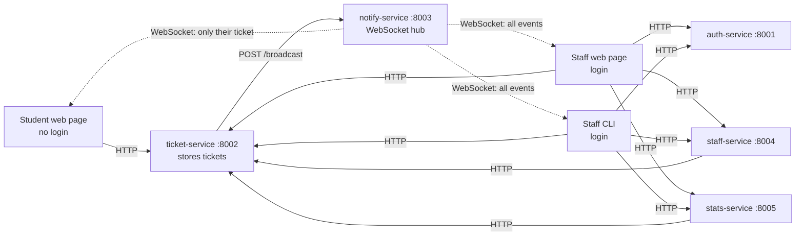

# Architecture

## The idea

Students report a problem (e.g. "Wi-Fi down in building B") **without logging
in**. They get back a ticket number and can watch its status change live on
the web page just by entering that number. Staff log in, pick up tickets,
assign them, and move them through `open → assigned → in_progress → done`.
Every change shows up instantly, for staff and for the student who owns that
ticket, with no page refresh.

It is simple because there is exactly one piece of data (a ticket) and one
thing that changes about it (its status). That is enough to justify 5
microservices and real-time WebSocket updates without extra complexity.

## Services

| Service | Port | Job | Talks to |
|---|---|---|---|
| auth-service | 8001 | Staff login only: `POST /login` checks username + password | nothing |
| ticket-service | 8002 | The only service that stores tickets: create, list, get one, update | notify-service, after every create/update |
| notify-service | 8003 | The only service with WebSockets: `POST /broadcast` pushes events to connected clients | nothing (pushes to clients) |
| staff-service | 8004 | Staff list and `POST /assign`. Does not store tickets, it asks ticket-service to update | ticket-service |
| stats-service | 8005 | `GET /stats`: counts tickets by status | ticket-service |

## How the pieces connect

Rules shown in the chart:

- Students only ever talk to ticket-service. They never touch auth-service.
- Only ticket-service calls notify-service. staff-service and stats-service
  always go through ticket-service instead of storing or broadcasting
  anything themselves.
- notify-service sends **all** events to staff, and a student only receives
  events for their own ticket. Staff connect with
  `ws://localhost:8003/ws?role=staff`, students with
  `ws://localhost:8003/ws?ticket=<id>`.

## Clients

The web client is 3 plain HTML pages plus one shared stylesheet (`style.css`)
and one shared script (`stepper.js`), with no build step and no framework, in
`clients/web_client/`:

- **`index.html`**: a landing page with two links, "Student" and "Staff".
- **`student.html`**: no login. A form (name + problem) submits to
  ticket-service and shows "Your ticket #4". A "Track a ticket" box looks up
  any ticket number, opens a WebSocket scoped to that ticket, and shows a
  4-step animated progress tracker (open, assigned, in progress, done).
- **`staff.html`**: one-click demo login (`carol` or `dave`), then one card
  per ticket with the same progress tracker, a status dropdown, an "Assign to
  me" button, a stats panel and a live updates log. It opens a `role=staff`
  WebSocket on login, so every card refreshes the moment anything changes.

There is also a **staff CLI** (`clients/cli_client/cli.py`): it asks for
username and password against auth-service, then offers a menu (list tickets,
change status, assign ticket, view stats, quit). A background thread holds a
`role=staff` WebSocket and prints `[LIVE]` events as they arrive. The staff
web page and the staff CLI are two independent clients of the same services.

## Data

No database. Tickets live in a Python list inside `ticket-service`. The staff
logins live in a hardcoded dict inside `auth-service`. No Docker: every
service is one `main.py` run directly with `python3`.
