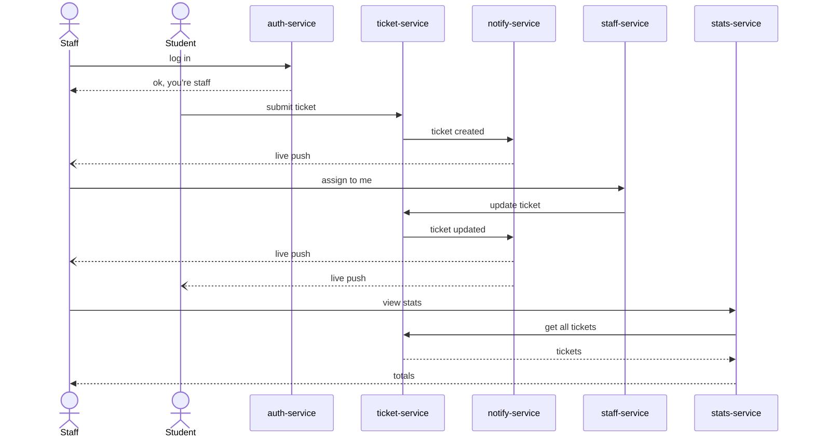
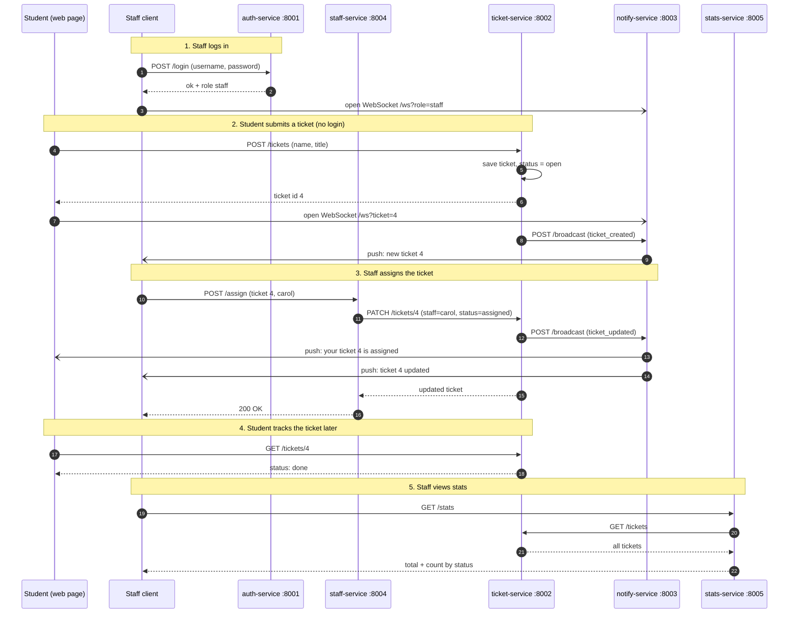

# Sequence diagrams

## Simple version

One ticket, start to finish, through all five services: staff logs in, a
student reports a problem, staff sees it and picks it up live, and staff
checks the dashboard.

Solid arrows are plain HTTP calls between services. Dashed arrows are the
WebSocket push that notify-service sends out. Staff always gets it, and a
student only gets it for the one ticket they are watching.

## Detailed version

The same flow with the real endpoints, ports and WebSocket connections.

